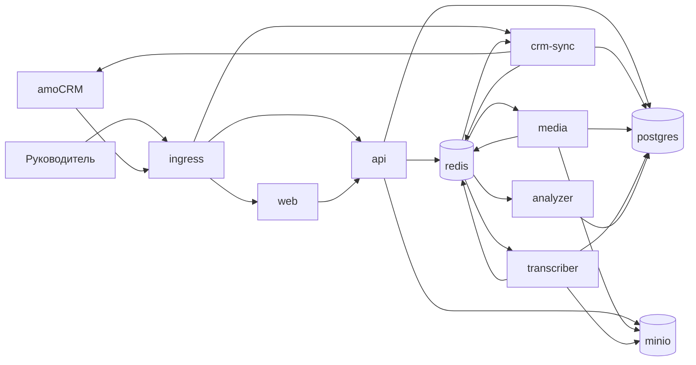

# Архитектура

Шесть прикладных сервисов и четыре инфраструктурных контейнера. У каждого прикладного сервиса один понятный результат. Общая схема чтения для интерфейса: amoCRM → синхронизация → PostgreSQL → API → экран. Интерфейс amoCRM сам не вызывает.

## Контейнеры

| Контейнер | Тип | Результат |
| --- | --- | --- |
| `ingress` | инфраструктура | Один внешний HTTPS-вход |
| `web` | сервис | Экраны Call Analytics |
| `api` | сервис | JSON для экранов и запись настроек |
| `crm-sync` | сервис | Звонки и справочники amoCRM в нашей базе, задания на скачивание записи |
| `media` | сервис | Файл записи в хранилище |
| `transcriber` | сервис | Транскрипт с ролями и таймкодами |
| `analyzer` | сервис | Оценки этапов и итог |
| `postgres` | инфраструктура | Единая база |
| `redis` | инфраструктура | Очереди заданий |
| `minio` | инфраструктура | Файлы записей, протокол S3 |

`ingress`, `postgres`, `redis` и `minio` не содержат продуктовой логики. Их входы и выходы короткие и перечислены ниже. Подробные контракты прикладных сервисов — в [services/](services/README.md).

Почему оценка не выделена в отдельный «калькулятор»: это формула из пяти чисел и весов, она выполняется в конце `analyzer` в той же транзакции, что и сохранение комментариев. Отдельный контейнер появится, только если способ расчёта станет самостоятельным продуктом.

Почему приём webhook не вынесен из `crm-sync`: приёмник только кладёт сырое событие в очередь и отвечает `200`. Разбор события делает тот же сервис. Отдельный контейнер имел бы тот же контракт и ту же базу.

## Схема



## Внешние маршруты

`ingress` принимает только эти пути:

| Путь | Куда |
| --- | --- |
| `/` и страницы приложения | `web` |
| `/api/*` | `api` |
| `/webhooks/amocrm` | `crm-sync` |
| `/oauth/amocrm/*` | `crm-sync` |

Остальные сервисы снаружи не публикуются.

## Счастливый путь одного звонка

1. Телефония пишет в amoCRM примечание `call_in` или `call_out`.
2. amoCRM вызывает `POST /webhooks/amocrm`.
3. `crm-sync` сохраняет сырое событие и сразу отвечает `200`.
4. Тот же сервис читает примечание через API amoCRM, проверяет длительность и дубль, находит менеджера, контакт и сделку.
5. Если ссылка на запись уже есть, в очередь уходит задание `calls.audio.fetch`.
6. `media` скачивает файл и кладёт его в `minio`.
7. `transcriber` читает файл и пишет транскрипт.
8. `analyzer` читает транскрипт и контекст сделки, пишет оценки, считает итог.
9. Статус звонка становится `completed`.
10. Следующее открытие таблицы забирает строку из PostgreSQL через `api`. В amoCRM за этим экраном обращений нет.

Резервный опрос amoCRM каждые 90 секунд ищет те же примечания, если webhook не пришёл. Повторная обработка того же `external_call_id` не создаёт второй анализ.

## Очереди

Общий конверт любого задания:

```json
{
  "message_id": "uuid",
  "call_id": "uuid",
  "attempt": 1,
  "enqueued_at": "2026-10-05T20:15:00+03:00"
}
```

Поле `attempt` начинает с 1. Сервис, который повторяет задание, увеличивает его на 1. После третьей неудачной попытки сервис пишет в звонок статус `failed` и причину. Следующее сообщение в конвейер при этом не отправляется.

| Очередь | Кто публикует | Кто читает | Смысл |
| --- | --- | --- | --- |
| `crm.events` | `crm-sync` | `crm-sync` | Сырой webhook или найденное опросом примечание |
| `crm.commands` | `api` | `crm-sync` | Ручное обновление или первичный импорт |
| `calls.audio.fetch` | `crm-sync` | `media` | Пора скачать запись |
| `calls.transcribe` | `media` | `transcriber` | Файл лежит в хранилище |
| `calls.analyze` | `transcriber` | `analyzer` | Транскрипт готов |

Тело сообщения сверх конверта описано во входном разделе сервиса-читателя.

Повторы идемпотентны: повторная доставка того же `call_id` на уже пройденный этап не создаёт второй файл, второй транскрипт и вторую оценку. Сервис дописывает результат, если его ещё нет, и публикует следующее задание, если предыдущая публикация не подтвердилась.

Параллельность воркеров `transcriber` и `analyzer` ограничена настройкой, чтобы первичный импорт за 30 дней не отправил сотни запросов одновременно. Предлагаемые стартовые значения: 2 и 2.

## Статусы звонка

Поле `calls.processing_status`:

| Статус | Кто ставит | Когда |
| --- | --- | --- |
| `recording_pending` | `crm-sync` | Звонок принят, ссылки на запись ещё нет |
| `recording_missing` | `crm-sync` или `media` | Ссылки нет после повторов, либо файл по ссылке уже недоступен (404, 410) |
| `audio_queued` | `crm-sync` | Ссылка есть, задание на скачивание опубликовано |
| `audio_fetch` | `media` | Задание на скачивание взято в работу |
| `transcribing` | `transcriber` | Файл получен, идёт распознавание |
| `analyzing` | `analyzer` | Транскрипт есть, идёт оценка |
| `completed` | `analyzer` | Оценки и итог записаны |
| `failed` | сервис этапа | Три попытки этапа не удались |

Звонок короче порога в эту таблицу не попадает и статуса не имеет.

Ошибка хранится на звонке:

```json
{
  "stage": "transcribe",
  "message": "пустой ответ распознавания",
  "attempts": 3,
  "failed_at": "2026-10-05T20:40:00+03:00"
}
```

`stage` принимает значения `resolve`, `audio`, `transcribe`, `analyze`.

Отдельно: HTTP 404 или 410 при скачивании записи переводит звонок в `recording_missing` без трёх повторов. Сетевая ошибка и ответ 5xx идут по обычным трём попыткам и заканчиваются `failed`.

## Владение данными

Одна база. Пишет в таблицу только владелец. Остальные читают.

| Данные | Пишет | Читают |
| --- | --- | --- |
| `amo_events` | `crm-sync` | `crm-sync` |
| `accounts` | `crm-sync` | `crm-sync`, `api` |
| `managers` | `crm-sync` | `api`, `analyzer` |
| `contacts` | `crm-sync` | `api` |
| `calls` (карточка и связи) | `crm-sync` | все прикладные сервисы |
| `calls.recording_storage_key`, статус на этапе аудио | `media` | `transcriber`, `api` |
| `call_analysis.transcript_json` | `transcriber` | `analyzer`, `api` |
| оценки, комментарии, итог | `analyzer` | `api` |
| `settings` | `api` | `crm-sync`, `media`, `transcriber`, `analyzer` |
| `telephony_extensions` | `api` | `crm-sync` |
| справочник воронок и статусов | `crm-sync` | `api` |
| объекты аудио | `media` | `transcriber`, `api` (подпись ссылки для плеера) |

Миграции схемы — один общий каталог, применяется отдельным шагом выкладки до запуска сервисов. Ни один сервис не меняет схему при старте.

## Инфраструктура

### `ingress`

Вход: HTTPS-запросы пользователей и webhook amoCRM. Выход: проксирование на `web`, `api` или `crm-sync` по таблице маршрутов. Сертификат терминируется здесь.

### `postgres`

Вход: SQL от `api`, `crm-sync`, `media`, `transcriber`, `analyzer`. Выход: строки таблиц из [data-model.md](data-model.md). Снаружи порт не публикуется.

### `redis`

Вход: команды постановки и чтения очередей из таблицы выше. Выход: сообщение конверта следующему потребителю. Долгосрочные данные продукта в Redis не хранятся. Снаружи порт не публикуется.

### `minio`

Вход: файл от `media` по ключу `calls/{call_id}.{ext}`. Выход: тот же файл для `transcriber` и подписанная ссылка, которую `api` отдаёт плееру. Бакет один: `recordings`. Снаружи порт не публикуется.

## Секреты по контейнерам

| Контейнер | Секреты |
| --- | --- |
| `crm-sync` | клиент OAuth amoCRM, секрет приложения, секрет пути webhook |
| `media` | ключ доступа к `minio`; при необходимости ключ API телефонии |
| `transcriber` | ключ провайдера распознавания речи |
| `analyzer` | ключ LLM и имя модели |
| `api` | строка подключения к базе и ключ подписи ссылок на записи |
| `web` | публичный адрес API на этапе сборки |

Токены amoCRM (`access_token`, `refresh_token`, срок) лежат в `accounts` и обновляются только сервисом `crm-sync`.
