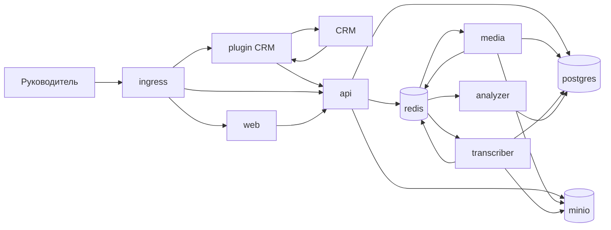

# Архитектура

Ядро — пять прикладных контейнеров и четыре инфраструктурных. Прикладные сервисы и плагин пишутся на TypeScript. Плагин CRM в это число не входит: это отдельный необязательный контейнер со своей базой. Без него проект принимает звонки вручную и доводит их до оценки.

Репозиторий — npm workspaces. Сервисы ядра с HTTP и очередями — приложения NestJS, у каждого свой пакет. `web` остаётся статическим интерфейсом. Общий пакет — один HTTP-клиент chat-completions; из сервисов его вызывает только `analyzer`. Границы контейнеров от этого не меняются.

Первая установка — один сервер и один `docker-compose`. На нём поднимаются ядро, плагин, когда он подключён, PostgreSQL, Redis и хранилище. Отдельного облачного бакета нет. У каждого прикладного сервиса есть проверка живости. У запущенного плагина она тоже есть.

Общая схема чтения экрана: источник → `api` → PostgreSQL → `api` → экран. Экран и `api` в CRM не ходят.

## Контейнеры ядра

| Контейнер | Тип | Результат |
| --- | --- | --- |
| `ingress` | инфраструктура | Один внешний HTTPS-вход |
| `web` | сервис | Экраны проекта |
| `api` | сервис | Приём звонка, настройки проекта, JSON экранов |
| `media` | сервис | Файл записи в хранилище |
| `transcriber` | сервис | Транскрипт с ролями и таймкодами |
| `analyzer` | сервис | Оценки этапов проекта и итог |
| `postgres` | инфраструктура | База ядра |
| `redis` | инфраструктура | Очереди конвейера |
| `minio` | инфраструктура | Файлы записей, протокол S3 |

Ручная загрузка — метод `api`, отдельный контейнер ей не нужен. Оценка остаётся внутри `analyzer`: итог — формула по весам карточки проекта, она записывается вместе с комментариями.

Контейнер `plugin-amocrm` описан в [plugins/amocrm.md](plugins/amocrm.md). Его поднимают только для этой связки. Следующая CRM — такой же отдельный контейнер, тот же [контракт приёма](intake.md).

## Схема



Стрелка от CRM к `plugin` есть только у установленного плагина. Ядро с CRM не соединено.

## Внешние маршруты

| Путь | Куда |
| --- | --- |
| `/` и страницы приложения | `web` |
| `/api/*` | `api` |
| `/plugins/amocrm/*` | `plugin-amocrm`, если контейнер запущен |

`media`, `transcriber`, `analyzer`, `postgres`, `redis` и `minio` снаружи не публикуются.

## Два входа одного конвейера

Ручная загрузка:

1. Человек отправляет файл и карточку на `POST /api/projects/{project_id}/calls`.
2. `api` проверяет порог, если длительность уже передана, пишет строку и кладёт файл в `minio`.
3. В очередь уходит `calls.audio.fetch` с типом `object`.
4. Дальше общий хвост: `media` → `transcriber` → `analyzer`.

Плагин:

1. Плагин сам разбирает событие своей CRM.
2. В ядро уходит тот же `POST` с `external_id` и, когда файл уже доступен без секретов CRM, с `recording.url`.
3. Если файла ещё нет, строка получает `recording_pending`. Ядро этот статус не опрашивает и про CRM не знает. Ожидание ссылки, которой ещё нет, остаётся на плагине. Пока статус `recording_pending`, ядро принимает поздний файл.
4. `api` публикует `calls.audio.fetch` с типом `url`. Секреты CRM в сообщении отсутствуют.
5. Хвост конвейера тот же.

Повтор того же `external_id` второй анализ не создаёт.

## Очереди ядра

Общий конверт:

```json
{
  "message_id": "uuid",
  "project_id": "uuid",
  "call_id": "uuid",
  "attempt": 1,
  "enqueued_at": "2026-10-13T12:00:00+03:00"
}
```

`attempt` начинается с 1. После третьей неудачной попытки сервис этапа пишет статус `failed` и причину. Следующее сообщение конвейера при этом не публикуется.

| Очередь | Кто публикует | Кто читает | Смысл |
| --- | --- | --- | --- |
| `calls.audio.fetch` | `api` | `media` | Есть URL или уже лежащий файл |
| `calls.transcribe` | `media` | `transcriber` | Файл в хранилище, длительность известна и не ниже порога |
| `calls.analyze` | `transcriber` | `analyzer` | Транскрипт готов |

Очереди плагина в эту таблицу не входят. У плагина amoCRM свои имена с префиксом `plugin.amocrm.`. Воркеры ядра их не читают. Плагин не публикует `calls.*`: задание на аудио ставит только `api` после приёма контракта.

Повторная доставка того же `call_id` на уже пройденный этап не создаёт второй файл, второй транскрипт и вторую оценку.

Распознавание и оценка идут отдельными очередями и вызывают внешние API. У каждого свой потолок одновременных заданий: столько, сколько запросов этого типа провайдер принимает сразу. Потолок задаётся окружением сервиса.

Один проект не занимает весь потолок. Если потолок равен 1, этот слот можно занять. Если потолок 2 или больше, один слот этого типа остаётся другому проекту и не отдаётся тому же, даже когда другие проекты не ждут. Остальные слоты проект занять может, в том числе несколько заданий одного типа. Предел «одно задание типа на проект» совпадает с этим правилом только при потолке 1 или 2: тогда проекту доступен один слот. Импорт истории подчиняется тому же правилу.

Свободный слот получает проект, который ждёт дольше.

## Статусы звонка

Поле `calls.processing_status`:

| Статус | Кто ставит | Когда |
| --- | --- | --- |
| `recording_pending` | `api` | Карточка принята, файла ещё нет |
| `recording_missing` | `api` или `media` | Источник сообщил, что записи не будет, либо URL ответил 404 или 410 |
| `audio_queued` | `api` | Задание на файл опубликовано |
| `audio_fetch` | `media` | Задание взято в работу |
| `skipped_short` | `media` | Длительность из файла ниже порога проекта. Провайдер речи не вызывается |
| `skipped_no_duration` | `media` | Длительность из метаданных и из файла не прочиталась. Провайдер речи не вызывается |
| `transcribing` | `transcriber` | Идёт распознавание |
| `analyzing` | `analyzer` | Идёт оценка |
| `completed` | `analyzer` | Оценки и итог записаны |
| `failed` | сервис этапа | Три попытки этапа не удались |

Если `duration_sec` известен уже в `POST` и он ниже порога, `api` отвечает `422` и строку не создаёт.

До платного распознавания длительность должна быть известна. Ниже порога проекта сообщение `calls.transcribe` не публикуется, статус `skipped_short`. Если длительность прочитать нельзя, сообщение тоже не публикуется, статус `skipped_no_duration`. Это не `failed`.

Ошибка на звонке:

```json
{
  "stage": "transcribe",
  "message": "пустой ответ распознавания",
  "attempts": 3,
  "failed_at": "2026-10-13T12:40:00+03:00"
}
```

`stage`: `audio`, `transcribe`, `analyze`.

Сетевая ошибка и ответ 5xx на скачивании идут по трём попыткам и заканчиваются `failed`. Ответ 404 или 410 сразу даёт `recording_missing`.

## Владение данными ядра

Одна база ядра. Пишет в таблицу только владелец. Плагин в эту базу не подключается.

| Данные | Пишет | Читают |
| --- | --- | --- |
| `accounts`, `project_memberships` | `api` | `api` |
| `project_inputs` | `api` | `analyzer` читает только скрипты |
| `scorecards` | `api` | `analyzer` читает только промпт |
| `projects` | `api` | `api`; `media` читает только порог длительности |
| `sources` | `api` | `api` |
| `managers`, `contacts` | `api` | `api` |
| карточка `calls`: контекст, внешние адреса, менеджер, контакт, сделка | `api` | `api` |
| `calls.direction` | `api` | `transcriber`, `api` |
| `recording_storage_key`, уточнённая длительность, статус аудио | `media` | `media`, `api` |
| `call_analysis.transcript_json` | `transcriber` | `analyzer`, `api` |
| снимок этапов, комментарии, итог | `analyzer` | `api` |
| объекты аудио | `api` для прямой загрузки, `media` для скачивания по URL | `transcriber`, `api` |

`analyzer` для оценки читает транскрипт, промпт и скрипты. Менеджеров, контакты и карточку звонка он не читает. `transcriber` читает файл записи и направление звонка, карточку оценки не читает.

Ключ объекта: `projects/{project_id}/calls/{call_id}.{ext}`.

Миграции ядра — один каталог, применяются отдельным шагом выкладки до запуска сервисов. Схема плагина живёт в его собственной базе и этим каталогом не управляется.

## Инфраструктура

### `ingress`

Вход: HTTPS пользователей и, при установленном плагине, webhook CRM на `/plugins/amocrm/*`. Выход: проксирование по таблице маршрутов. Сертификат терминируется здесь. Вызовы плагина к `/api` идут по внутренней сети и снаружи не публикуются отдельным маршрутом.

### `postgres`

Вход: SQL от `api`, `media`, `transcriber`, `analyzer`. Выход: строки из [data-model.md](data-model.md). Порт снаружи не публикуется. База плагина — другой логический database на том же сервере или отдельный сервер; таблиц CRM в базе ядра нет.

### `redis`

Вход: постановка и чтение очередей ядра. Выход: конверт следующему потребителю. Долгосрочные данные продукта здесь не хранятся. Плагин может использовать тот же Redis только со своим префиксом.

### `minio`

Вход: файл от `api` или `media`. Выход: тот же файл для `transcriber`. Плеер получает байты через `api`, не через адрес хранилища. Бакет один: `recordings`. Порт наружу не публикуется.

## Секреты ядра

| Контейнер | Секреты |
| --- | --- |
| `api` | строка подключения к базе ядра, ключ `minio`, секрет подписи сессии входа |
| `media` | ключ доступа к `minio` |
| `transcriber` | ключ внешнего API распознавания речи |
| `analyzer` | ключ внешнего API языковой модели и её имя |
| `web` | публичный адрес API на этапе сборки |

Токен CRM, секрет OAuth и ключ телефонии в этой таблице отсутствуют. Их держит контейнер плагина.

Проверка аккаунта и роли живёт в `api`: отдельного контейнера авторизации нет. Плагин по-прежнему ходит в приём звонков со своим `source_token`, без сессии человека.
